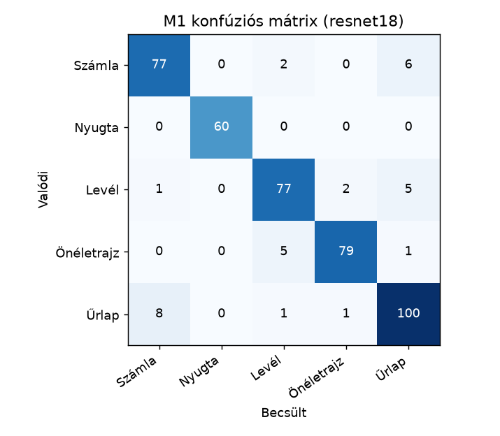
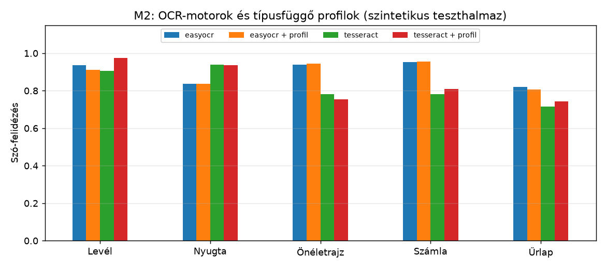
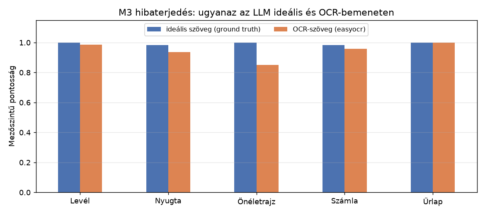
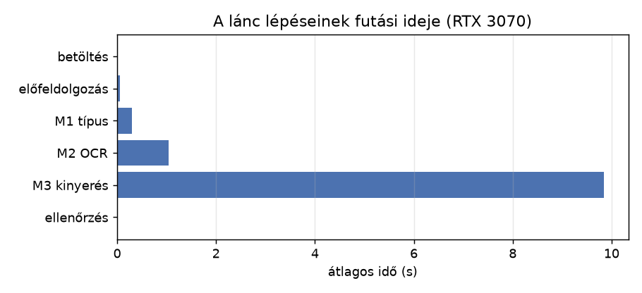

# DokuLánc – többmodelles dokumentumfeldolgozó lánc

**Projekttípus:** 1. – legalább három AI-modellből álló feldolgozási lánc
**Csapat:** _(nevek)_

## 1. A probléma és a cél

Papíralapú vagy szkennelt dokumentumok (számlák, nyugták, levelek, önéletrajzok, kitöltött űrlapok) adatait sok
helyen ma is kézzel viszik be. Ez lassú, és könnyű elírni egy összeget, adószámot vagy dátumot.

A DokuLánc egy telefonnal fotózott vagy szkennelt dokumentumból (kép vagy PDF) automatikusan:

1. felismeri a dokumentum **típusát**,
2. kinyeri a **szövegét** a sorok helyével és megbízhatóságával együtt,
3. a típusnak megfelelő **strukturált adatokat** állít elő (JSON), minden adatnál megjelölve, melyik sorból származik,
4. **ellenőrzi** az adatokat (összegek, ellenőrző számjegyek, dátumok, és hogy az adat tényleg szerepel-e a szövegben),
5. megjeleníti az eredményt egy webes felületen, ahol javítani és exportálni (JSON, CSV) lehet.

## 2. Felhasznált modellek, eszközök

| Lépés | Modell / eszköz | Feladat |
|---|---|---|
| M1 | ResNet-18 (ImageNet-előtanított, **saját adaton finomhangolva**); összevetve MobileNetV3-Large és EfficientNet-B0 | dokumentumtípus felismerése a kép alapján |
| M2 | EasyOCR (CRAFT szövegdetektor + CRNN felismerő, magyar modell); összevetve Tesseract 5 (`hun`, tessdata_best) | szövegfelismerés soronként, koordinátával és konfidenciával |
| M3 | Qwen2.5-7B-Instruct, helyben, Ollamával, JSON-sémához kötött (structured output) válasszal | típusfüggő adatkinyerés; bizonytalan M1 esetén típusbecslés a szöveg alapján |
| – | OpenCV, PyMuPDF | előfeldolgozás (perspektíva- és dőlésjavítás, típusfüggő képjavítás), PDF-betöltés |
| – | PyTorch / torchvision, scikit-learn | tanítás, metrikák |
| – | pydantic, rapidfuzz, Faker | sémák, szöveg-összevetés, szintetikus adatok |
| – | Streamlit, pytest | felület, egységtesztek |

Futtatókörnyezet: Python 3.12, NVIDIA RTX 3070 (8 GB); mindhárom modell helyben, internetkapcsolat nélkül fut.

## 3. A rendszer felépítése

```
kép / PDF
  │
  ├─ előfeldolgozás: dokumentum kontúrjának keresése → perspektíva-kiegyenesítés → dőlésszög-becslés (vetületi profil)
  ▼
 M1 típusfelismerő ──► típus + valószínűségek
  │   a típus kiválasztja az OCR-előfeldolgozási profilt (nyugta: felskálázás + élesítés; számla, űrlap: vonaleltávolítás)
  ▼
 M2 OCR ──► szövegrészek → sorokba és (oldalsávos elrendezésnél) hasábokba rendezve, nagy hézagnál „ | ” jellel
  │
  ├─ ha M1 legnagyobb valószínűsége < 0,6: M3 a szöveg alapján is megbecsüli a típust;
  │   eltérés esetén az LLM döntése érvényes, és ha a profil változik, az OCR újrafut
  ▼
 M3 adatkinyerés ──► típusfüggő pydantic séma szerinti JSON, minden mezőnél {érték, forrássor}
  ▼
 ellenőrző réteg ──► mezőnként OK / figyelmeztetés / hiba
  ▼
 Streamlit felület, CLI, JSON / CSV export
```

A lépések egy közös `Document` objektumot egészítenek ki (`image`, `doc_type`, `type_probs`, `ocr_lines`, `fields`,
`checks`, `timings`), így minden modul önállóan fejleszthető és tesztelhető volt.

## 4. Saját fejlesztés

- **Szintetikus dokumentumgenerátor** (`synth.py`): öt dokumentumtípus változatos elrendezéssel, betűtípussal
  (kézírásos űrlapkitöltéssel is), érvényes ellenőrző számjegyű adószámokkal, IBAN-nal, TAJ-számmal és
  adóazonosító jellel. Minden dokumentumhoz eltárolja a **helyes mezőértékeket és a szöveg sorait**, így az OCR és az
  adatkinyerés pontosan mérhető. „Szkennelt” (zaj, enyhe dőlés, elmosás) és „fotózott” (háttér, perspektíva,
  árnyék, JPEG) változatot is készít. A dokumentumok egy része szándékosan hibás (rossz végösszeg, hibás adószám,
  lejárt határidő, hibás TAJ-szám) az ellenőrző réteg teszteléséhez.
- **M1 tanítása:** RVL-CDIP részhalmaz (levél, űrlap/kérdőív, számla, önéletrajz) + 2100 szintetikus magyar
  dokumentum; két fázis (csak az osztályozó fej, majd a teljes háló), augmentáció, label smoothing, három architektúra
  összevetése, a legjobb validációs makró F1 alapján választva.
- **Előfeldolgozás:** dokumentumkeresés (Otsu-küszöb és Canny-élek, négyszög-közelítés), perspektíva-transzformáció,
  dőlésbecslés vetületi profillal, típusfüggő OCR-profilok. A kép szélét érintő négyszöget elveti (ilyenkor a háttér
  egy része „összeolvadt” a papírral, és a torzítás rontana a képen), ekkor csak a dőlést javítja.
- **Sorokba és hasábokba rendezés:** az OCR-motorok szövegdarabjait sorokká fűzi; függőleges hézag alapján felismeri
  az oldalsávos (kéthasábos) elrendezést, de a táblázatsorokat (ahol a két oldal sorai egy magasságban vannak) nem vágja szét.
- **LLM-lépés:** típusonkénti sémák és promptok, sémához kötött kimenet, validálás és újrapróbálás, típus-visszacsatolás.
  A sémákban a szövegek hossza és a listák mérete korlátozott (`maxLength`, `maxItems`), mert a modell ritkán
  ismétlési hurokba kerül (pl. „821 821 821 …”); a korlát miatt a generálás ilyenkor is lezárul.
- **Ellenőrző réteg** (`validation.py`): nettó + ÁFA = bruttó, tételösszegek, tételenként mennyiség × egységár és
  nettó × kulcs, létező ÁFA-kulcsok, adószám-, bankszámlaszám-, IBAN-, TAJ- és adóazonosító-ellenőrzés, az
  adóazonosító jelben kódolt születési dátum összevetése a megadottal, dátumok logikája; **hallucináció-szűrés**
  (a kinyert érték normalizálva vagy fuzzy egyezéssel megtalálható-e a forrássorban / a szövegben), alacsony
  OCR-konfidenciájú forrássor és gyenge képminőség (alacsony átlagos konfidencia) jelzése.
  **Súlyossági elv:** „hiba” csak bizonyítható ellentmondás (ellenőrző számjegy, összegek, dátumsorrend, az
  adóazonosító jelben kódolt születési dátum); ami nem olvasható vagy nem ellenőrizhető, az „figyelmeztetés”.
- **Javító lépések a láncban** (`repair.py`), mindegyik figyelmeztetéssel jelzi, mit módosított:
  - *aritmetikai rekonstrukció*: ha az OCR egybeolvassa egy számlatétel oszlopait, a forrássor számjegycsoportjaiból
    megkeresi azt az egyetlen felbontást, amelyre mennyiség × egységár = nettó és nettó × (1 + ÁFA-kulcs) = bruttó;
    kezeli a kieső számjegyet és a „%” jel „9”/„96”-ként olvasását is;
  - *címke alapú tartalék*: ha az LLM végösszege nem használható, a „Nettó összesen”, „ÁFA összesen”, „Végösszeg”
    (nyugtán „ÖSSZESEN”, „FIZETENDŐ”) címkés sorból olvassa ki;
  - *eladó–vevő csere felismerése* a címkék sorrendje és a nevek sorbeli oldala alapján;
  - *OCR-karaktercsere* (O→0, I/l→1) az azonosítókban, ha csak így érvényes az ellenőrző számjegy.
- **Kiértékelő szkriptek**, **CLI** és **Streamlit felület** (lépésenkénti eredmények, OCR-dobozok a képen,
  szerkeszthető mezők újraellenőrzéssel, futási idők, export).

## 5. Tesztelés és eredmények

Teszthalmaz: a tanításhoz nem használt 300 szintetikus dokumentum (típusonként 60) és 125 RVL-CDIP kép.
Az egységtesztek (`pytest`, 72 teszt) a segédfüggvényeket, az ellenőrző réteget (a generátor ép és elrontott
dokumentumain), az előfeldolgozást, a sorba rendezést, a sémákat és az LLM-integrációt fedik le.

### 5.1 M1 – típusfelismerés

| Architektúra | Teszt accuracy | Makró F1 | Paraméter | Tanítási idő |
|---|---|---|---|---|
| ResNet-18 (kiválasztott) | 0,925 | 0,931 | 11,2 M | 142 s |
| EfficientNet-B0 | 0,932 | 0,938 | 4,0 M | 194 s |
| MobileNetV3-Large | 0,918 | 0,924 | 4,2 M | 191 s |

A modellt a validációs makró F1 alapján választottuk (ResNet-18: 0,943); a teszthalmazon az EfficientNet-B0
minimálisan jobb, a különbség 1–2 kép.

| Forrás | db | Accuracy |
|---|---|---|
| szintetikus – tiszta / szkennelt / fotózott | 62 / 125 / 113 | 1,00 / 1,00 / 1,00 |
| RVL-CDIP (valós, régi angol nyelvű szkennek) | 125 | 0,74 |

Mind a 32 téves besorolás RVL-CDIP-kép (leggyakrabban űrlap ↔ számla, levél ↔ űrlap). A 0,6-os küszöb alá eső
33 predikció közül 17 hibás, ezeknél a láncban az LLM-visszacsatolás lép közbe.



### 5.2 M2 – szövegfelismerés

50 tesztdokumentumon (típusonként 10, vegyesen tiszta, szkennelt és fotózott), a helyes szöveghez viszonyítva.
Fő mérőszám a **szó-felidézés** (a helyes szavak hány százaléka szerepel a felismert szövegben), mert a CER az
olvasási sorrendre is érzékeny (a többhasábos önéletrajzoknál emiatt magas).

| Motor | Típusfüggő profil | Szó-felidézés | CER | Idő / oldal |
|---|---|---|---|---|
| **EasyOCR** | nincs | **0,897** | 0,082 | 0,70 s |
| EasyOCR | van | 0,891 | 0,092 | 0,79 s |
| Tesseract 5 | nincs | 0,824 | 0,151 | 1,04 s |
| Tesseract 5 | van | 0,843 | 0,142 | 1,11 s |

| Változat | EasyOCR | Tesseract |
|---|---|---|
| tiszta | 0,943 | 0,914 |
| szkennelt | 0,913 | 0,900 |
| fotózott | **0,861** | **0,696** |

Típusonként (szó-felidézés, profil nélkül; EasyOCR / Tesseract): levél 0,94 / 0,91, nyugta 0,84 / 0,94,
önéletrajz 0,94 / 0,78, számla 0,95 / 0,78, űrlap 0,82 / 0,72.

**Tapasztalatok:** az EasyOCR lett az alapértelmezett, főleg a fotózott dokumentumokon sokkal jobb. A típusfüggő
profilok a Tesseractnál segítenek (számla és űrlap +2–3, levél +7 százalékpont), az EasyOCR-nél érdemben nem.
A monospace betűs nyugtákon a Tesseract jobb, ami típusfüggő motorválasztás lehetőségét veti fel.
Az űrlapok kézírásos betűtípusai mindkét motornak a legnehezebbek.



### 5.3 M3 – adatkinyerés és hibaterjedés

Ugyanazt az LLM-et ugyanazon a 40 dokumentumon (típusonként 8) kétféle bemenettel futtattuk: a generátor által
ismert **hibátlan szöveggel** és a valós **OCR-kimenettel**. A különbség megmutatja, mennyi hibát hoz be az OCR.
(Az alábbi számok a nyers LLM-kimenetet mérik, az ellenőrző réteg javításai nélkül.)

| Típus | Mezőpontosság – ideális szöveg | Mezőpontosság – OCR-szöveg |
|---|---|---|
| Levél | 1,000 | 0,986 |
| Nyugta | 0,984 | 0,938 |
| Önéletrajz | 1,000 | 0,850 |
| Számla | 0,983 | 0,958 |
| Űrlap | 1,000 | 1,000 |
| **Összesen** | **0,994** (hibátlan dokumentum: 95%) | **0,946** (hibátlan dokumentum: 80%) |

Változatonként az OCR-bemenettel: tiszta 0,993, szkennelt 1,000, fotózott 0,856, tehát a romlás szinte teljesen
a fotózott dokumentumokból jön. Listamezők: a számlatételek mezőpontossága 0,98 → 0,73, a nyugtatételeké
0,98 → 0,63 (az OCR egybeolvassa az oszlopokat, lásd 6. pont), az önéletrajz munkahelyeinek felidézése 1,00 → 0,92.
Az LLM-hívás átlagosan kb. 10 s dokumentumonként.

A hibák elemzése alapján javítottunk: pontosítottuk a nyugta- és önéletrajz-promptot (a „2 DB x ár” sorok és a
középiskolák kezelése), bevezettük a hasábfelismerést az oldalsávos önéletrajzokhoz, a dátumértelmező elfogadja az
OCR által elhagyott pontot („1980. 01 07”), és a sémákban korlátoztuk a szövegek hosszát az ismétlési hurkok ellen.



### 5.4 A teljes lánc

A teljes lánc (előfeldolgozás → M1 → M2 → M3 → ellenőrzés és javítás) 40 ép és 18 szándékosan elrontott
tesztdokumentumon:

| Mérőszám | Érték |
|---|---|
| Típusfelismerés (szintetikus) | 100% |
| Mezőpontosság ép dokumentumokon | **95,2%** (számla 99%, levél 97%, nyugta 95%, űrlap 94%, önéletrajz 90%) |
| Elrontott dokumentumoknál a beültetett hiba a megfelelő mezőn jelezve | **18 / 18 (100%)** |
| Ép dokumentumoknál „hiba” szintű jelzés | **3 / 40 (7,5%)** |
| Átlagos feldolgozási idő | 11,2 s (M1 0,3 s, M2 1,0 s, M3 9,8 s, a többi < 0,1 s) |

A 3 ép dokumentumnál jelzett hiba: egy szkennelt számlán a vevő magánszemély (nincs adószáma), az LLM mégis
egy OCR-zajból származó töredéket („246-”) adott vissza adószámként; két nyugtán pedig az OCR a tételösszeg melletti
ÁFA-kódot („A00”, „C00”) számként olvasta („400”), és az összegértelmező ezt hozzáfűzte a tételösszeghez
(„1277 400” → 1 277 400). Ez utóbbi az összegértelmező ismert hibája, a jelzés tehát jogos, de a hiba oka a kiolvasás.

**Az ellenőrző és javító réteg fejlődése** (ugyanezen a teszthalmazon mérve):

| Változat | Mezőpontosság | Beültetett hiba jelezve | Téves „hiba” ép dokumentumon |
|---|---|---|---|
| alap ellenőrzés | 93,5% | 17 / 18 | 37,5% |
| + aritmetikai rekonstrukció, kontextus szerinti súlyosság, OCR-karaktercsere | 93,7% | 17 / 18 | 20,0% |
| + súlyossági elv, címke alapú tartalék, eladó–vevő csere, szélet érintő négyszög elvetése, sémakorlátok | **95,2%** | **18 / 18** | **7,5%** |

**Típus-visszacsatolás valós képeken:** az RVL-CDIP tesztképek közül az a 17, amelyet M1 0,6 alatti
valószínűséggel és tévesen sorolt be, a teljes láncon (az eredeti képeken M1 ezek közül 5-öt helyesen sorol be):
a lánc végeredménye **9 / 17 helyes**. Az LLM 13 esetben döntött, 5 hibát javított, 1 helyes besorolást elrontott.

**Mintadokumentumok** (`data/samples`, 14 db): mind a 14 típusa helyes; a 3 szándékosan hibás dokumentumnál
pontosan a beültetett hiba jelenik meg; a 11 ép dokumentum közül 10 hibajelzés nélkül megy át, egy rossz minőségű
számlafotónál (átlagos OCR-konfidencia 0,45) a rendszer gyenge képminőséget és több ellentmondást jelez.



## 6. Tapasztalt hibák és korlátok

- **Szintetikus adat dominanciája:** a szintetikus teszthalmazon M1 100%-os, a valós RVL-CDIP képeken 74%-os.
  A generátor elrendezései korlátozottak, a valódi magyar dokumentumok változatosabbak; valós fotókat a
  `data/real/<típus>/` mappába téve külön tesztelhető a rendszer (a jelen eredmények ilyet nem tartalmaznak).
- **Táblázatok olvasása:** az OCR nem ismeri fel a táblázatszerkezetet, a szóközzel tagolt ezreseket nem tudja
  elválasztani az oszlophatártól. Az aritmetikai rekonstrukció a számláknál segít, a nyugtáknál nincs ilyen redundancia.
- **Fotózott dokumentumok:** a legtöbb mezőhiba a fotózott változatokból jön (rossz fény, elmosódás, perspektíva).
- **Többhasábos elrendezés:** a hasábfelismerés az oldalsávos önéletrajzok kb. 74%-át bontja helyesen; a küszöböt a
  szintetikus elrendezéseken állítottuk be.
- **LLM:** a 7B-s modell néha a szabály ellenére átalakítja az értéket (pl. dátumformátum, ezres tagolás),
  ritkán összecseréli az eladót és a vevőt, vagy egy sorral elcsúsztatja az összegeket. Ezt a hallucináció-szűrés
  és az aritmetikai ellenőrzés részben jelzi, a címke alapú tartalék és a csere-felismerés részben javítja.
  Egy dokumentum feldolgozása átlagosan 11 s (8–20 s), ennek kb. 85%-a az LLM.
- **Memória:** a fejlesztőgépen 8 GB videomemória és 8 GB rendszermemória van; az LLM egymagában 5,1 GB
  videomemóriát foglal. Az átnézés során kiderült, hogy a PyTorch az EasyOCR után nagy oldalaknál akár 3,6 GB-ot
  tartott lefoglalva, így a kettő együtt túllépte a videomemóriát, a Windows a rendszermemóriába lapozott, és egy
  hosszú kiértékelés a gép teljes memóriáját elfogyasztotta. Javítás: az EasyOCR munkavásznát 1800 képpontra
  korlátoztuk (a lapok ennél kisebbek, így felbontásveszteség nincs), és minden OCR-hívás után felszabadítjuk a
  CUDA-gyorsítótárat; a csúcs így kb. 2,0 GB. Más GPU-t használó programok mellett a feldolgozás még így is lassulhat.
- **Nyugták:** a tételösszegeknek nincs olyan redundanciája, mint a számla tételsorainak, ezért egy félreolvasott
  tételösszeg nem javítható, csak jelezhető (az összeg-ellenőrzés hibát ad).
- **Egyoldalas feldolgozás:** többoldalas PDF-nél csak az első oldalt dolgozza fel.
- **Kézírás:** csak kézírás-szerű betűtípusokkal teszteltük, valódi kézírással nem.

## 7. Munkamegosztás

| Csapattag | Feladatok |
|---|---|
| _(A)_ | adatgyűjtés, szintetikus generátor, RVL-CDIP előkészítés, M1 tanítása és kiértékelése |
| _(B)_ | előfeldolgozás, M2 (EasyOCR, Tesseract), sorokba és hasábokba rendezés, OCR-kiértékelés |
| _(C)_ | M3 (sémák, promptok, Ollama-kliens), ellenőrző réteg, Streamlit felület |
| közös | lánc összekötése, végponttól végpontig tesztelés, hibaterjedés-elemzés, dokumentáció, bemutató |

## 8. Források, külső kódok és modellek

- A. W. Harley, A. Ufkes, K. G. Derpanis: *Evaluation of Deep Convolutional Nets for Document Image Classification
  and Retrieval*, ICDAR 2015 (RVL-CDIP); részhalmaz: `jordyvl/rvl_cdip_100_examples_per_class` (Hugging Face)
- torchvision előtanított súlyok (ImageNet-1k): ResNet-18, MobileNetV3-Large, EfficientNet-B0
- EasyOCR (JaidedAI, Apache-2.0); Tesseract OCR 5 és `tessdata_best` magyar modell (Apache-2.0)
- Qwen2.5-7B-Instruct (Alibaba Cloud, Apache-2.0), Ollama
- Könyvtárak: PyTorch, OpenCV, PyMuPDF, Pillow, NumPy, pandas, scikit-learn, matplotlib, Faker, pydantic,
  rapidfuzz, requests, Streamlit, pytest
- A magyar adószám, bankszámlaszám, TAJ-szám és adóazonosító jel ellenőrző algoritmusai a nyilvánosan
  dokumentált súlyozási szabályok alapján, saját implementációban
